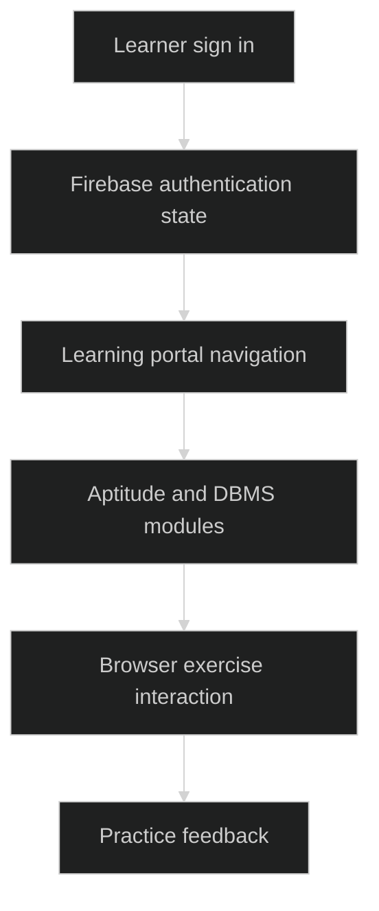

# LearnityX

> `A browser learning portal with aptitude practice, roadmaps and Firebase sign-in.`

### 🏗️ System Architecture



### 🛠️ Production Stack

HTML · CSS · JavaScript · Firebase Authentication

### ⚡ Key Engineering Capabilities

- Topic-specific modules organize quantitative and verbal practice.
- Roadmap pages group AI, DSA, full-stack and prompting learning material.
- Firebase browser authentication drives signed-in navigation.

### 🚀 Deployment and Local Setup

Run from the repository root after cloning:

```bash
git clone https://github.com/ryash14/LearnityX.git
cd LearnityX
python3 -m http.server 8080
```

Open http://localhost:8080. Configure the Firebase project and authorized domains for the target host. The source is a static learning portal; the previously documented React mock-interview architecture does not describe this repository. Firebase and CDN imports require connectivity.

### Source Map

- [index.html](index.html)
- [script.js](script.js)
- [aptitude/Algebra/script.js](aptitude/Algebra/script.js)
