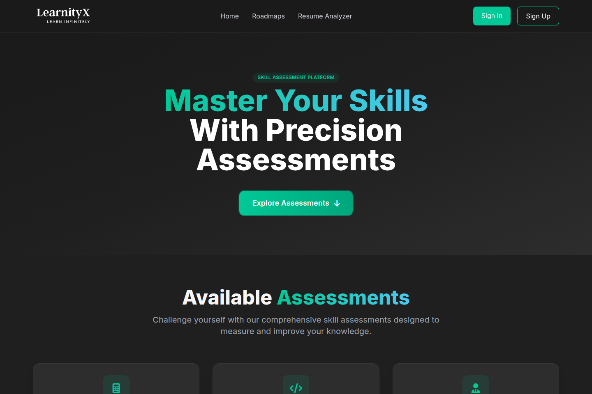
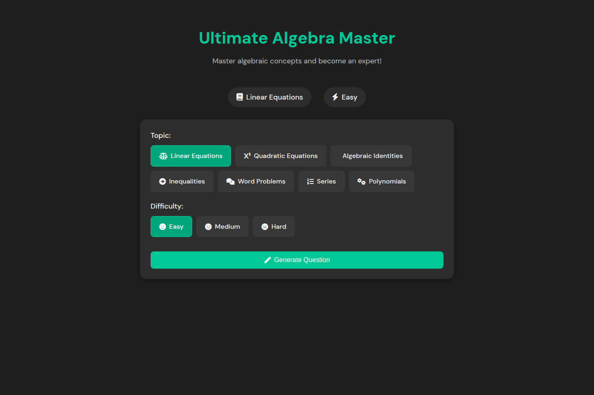

# LearnityX

LearnityX is a browser learning portal with aptitude exercises, technical roadmaps and Firebase sign-in.

The project organizes practice material into navigable topics instead of exposing a collection of unrelated exercise files. It is useful as a static learning interface and as an example of browser authentication around educational content.

[Preview](#application-preview) · [Quick start](#quick-start) · [Architecture](#architecture-and-request-flow) · [Development](#development) · [Contributing](CONTRIBUTING.md)

## Application preview



The learning portal groups assessment tracks and links to roadmap material.

<details>
<summary>LearnityX algebra practice controls</summary>



The algebra module lets a learner choose a topic and difficulty before generating an exercise.

</details>

[Screenshot notes](docs/screenshots/README.md)

## Capabilities

| Workflow | Result |
|---|---|
| Choose a track | Navigate aptitude, DBMS and technical roadmap material. |
| Practice in the browser | Use topic-specific exercise pages and interactions. |
| Manage access | Connect browser authentication to the configured Firebase project. |

## Quick start

Use a static HTTP server and configure Firebase authorized domains for the hostname you serve. Firebase and CDN-loaded scripts require network access.

From a fresh checkout:

```bash
git clone https://github.com/ryash14/LearnityX.git
cd LearnityX
python3 -m http.server 8080
```

Open http://localhost:8080. Configure the Firebase project and authorized domains for the target host. The source is a static learning portal; the previously documented React mock-interview architecture does not describe this repository. Firebase and CDN imports require connectivity.

## Architecture and request flow

1. Open the portal and sign in through the configured Firebase project.
2. Choose an aptitude, DBMS or roadmap section.
3. Work through the browser exercises and inspect topic-specific feedback.
4. Return to the portal to move between learning tracks.

### Engineering decisions

Each module is a static page with its own browser behavior. Shared navigation and authentication are handled with browser JavaScript. There is no checked-in React mock-interview backend in this repository; the source layout is the basis for this documentation.

## Implementation

**Stack:** HTML · CSS · JavaScript · Firebase Authentication.

- [index.html](index.html)
- [script.js](script.js)
- [aptitude/Algebra/script.js](aptitude/Algebra/script.js)

## Development

There is no complete automated verification command documented for this application. Start the affected component, use a small synthetic input and inspect its output before changing integrations. The contribution guide describes the evidence expected in a pull request.

## Contributing and support

Report reproducible bugs or propose changes through [GitHub Issues](https://github.com/ryash14/LearnityX/issues). Include the relevant environment and a small example rather than private datasets or credentials. See [contributing](CONTRIBUTING.md), [security reporting](SECURITY.md) and the [code of conduct](CODE_OF_CONDUCT.md).

## License

[MIT](LICENSE). Existing third-party notices remain applicable.
